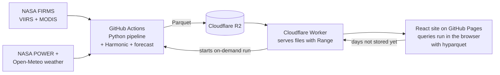

<p align="center">
  <picture>
    <source media="(prefers-color-scheme: dark)" srcset="frontend/src/assets/brand/agni-logo-text-white.svg">
    <source media="(prefers-color-scheme: light)" srcset="frontend/src/assets/brand/agni-logo-text-dark.svg">
    
  </picture>
</p>

<p align="center"><b>Active-fire Global Normalized Inventory</b><br>
NASA Space Apps Challenge 2026 · Harmonization of MODIS and VIIRS Hot Spots</p>

AGNI is a consistent record of active-fire detections over Australia, from November 2000 to today.
NASA's MODIS satellites have flown since 2000; the more sensitive VIIRS instruments since 2012.
Their raw counts cannot be compared directly. AGNI joins them into one series in VIIRS terms, so
every year can be compared fairly. A machine-learning model, **Harmonic**, converts MODIS
observations into VIIRS-equivalent detections for the years before VIIRS and for days when VIIRS
was down. New days arrive from NASA FIRMS every 3 hours.

- **Live site:** https://its-thakshila.github.io/AGNI/
- **Demo video:** [docs/agni-walkthrough.mp4](docs/agni-walkthrough.mp4)

## What it does

- **Map** of fire detections as fluid hotspot shapes, over NASA GIBS satellite backgrounds or a street map.
- **Draw an area** to limit every view and number to that region.
- **Month or day view**, with playback through time.
- **Calendar heatmap** of every month since 2000, shown as an amount or compared with the usual for that month.
- **Headline comparison** for the selected month, for example "77% above usual · Higher than most years · 6th of 25 years".
- **Month tab:** the month day by day, the same month in every year, and a CSV download of the detections.
- **Trends tab:** every year's total, the usual fire season, a typical year with the selected year over it, and the record month and year.
- **Forecast tab (experimental):** expected fire activity 1, 3 and 7 days ahead.
- **Provenance everywhere:** each value says whether it was observed by VIIRS, harmonized from MODIS, or gap-filled.

## How it works

There is no server. Everything runs on free plans.



1. **GitHub Actions** run the Python pipeline. Every 3 hours it fetches new fire-days from NASA
   FIRMS: VIIRS from Suomi-NPP, else NOAA-20/21, else MODIS converted by Harmonic. It later
   revisits stored days and upgrades them to NASA's final (standard) data once published.
   A nightly job merges finished days into the main dataset.
2. **Cloudflare R2** stores the dataset as Parquet files (summaries plus every detection, one file per year).
3. A free **Cloudflare Worker** serves those files with HTTP Range support, and starts the
   pipeline when the site asks for days that are not stored yet. It never calls FIRMS or runs the model itself.
4. The **React website** on GitHub Pages reads only the parts of the Parquet files it needs and
   answers every query in the browser with [hyparquet](https://github.com/hyparam/hyparquet).

See [docs/ARCHITECTURE.md](docs/ARCHITECTURE.md) for the full design and
[docs/API_CONTRACT.md](docs/API_CONTRACT.md) for the query contract the site implements.

## Harmonic

Harmonic (v8) is an XGBoost model that predicts VIIRS-equivalent detections from MODIS
(Terra and Aqua) observations, using fire-history, Aqua-growth and overpass-time features. AGNI
uses it for 2000–2011, before VIIRS, and to fill days when no VIIRS satellite has data. Gap-filled
rows are tagged `ML-XGB-1.0-gapfill`. Results are reliable as monthly totals, not as exact fire locations.

Cross-validated error:

| Input MODIS satellites | Monthly | Daily |
|------------------------|--------:|------:|
| Terra + Aqua           | ±3.1%   | ±10.7% |
| Terra only             | ±4.8%   | ±15.0% |

Details: [pipeline/harmonic/README.md](pipeline/harmonic/README.md).
Replacing the model or the dataset: [pipeline/MODEL_AND_DATA_UPDATE.md](pipeline/MODEL_AND_DATA_UPDATE.md).

## Forecast (experimental)

The forecast model (`FCST-XGB-1.0`) is one XGBoost model per lead time: 1, 3 and 7 days ahead.
For each 0.1° cell it uses 48 features: fire history (the cell, its neighbours, national totals,
season) and the weather of the target day (NASA POWER observed weather, Open-Meteo forecast,
plus fire-danger indices such as KBDI and FFDI). It runs once a day at 02:40 UTC.

Tested on 2025 (183 issue days):

| Lead   | National daily total error | Repeating the last day's fires |
|--------|---------------------------:|-------------------------------:|
| 1 day  | 29% | 59%  |
| 3 days | 35% | 106% |
| 7 days | 40% | 123% |

Details: [pipeline/forecast/README.md](pipeline/forecast/README.md).

## Repository

| Folder | Contents |
|--------|----------|
| [`frontend/`](frontend) | React + TypeScript website (Vite, MapLibre, ECharts, hyparquet). Includes a small mock dataset in `public/data/mock`. |
| [`worker/`](worker) | Cloudflare Worker: serves dataset files from R2 and starts on-demand processing. |
| [`pipeline/agni_pipeline/`](pipeline/agni_pipeline) | Python pipeline: fetch from FIRMS, run Harmonic, build and consolidate the dataset, run the forecast. |
| [`pipeline/harmonic/`](pipeline/harmonic) | Harmonic model code and trained model. |
| [`pipeline/forecast/`](pipeline/forecast) | Forecast model code and trained models. |
| [`pipeline/data_build/`](pipeline/data_build) | Builds the per-year Parquet files from the unified CSV ([guide](pipeline/data_build/DATA_BUILD_GUIDE.md)). |
| [`pipeline/tests/`](pipeline/tests) | Pipeline tests. |
| [`backend/`](backend) | Optional FastAPI implementation of the same API, for development. The live site does not use it. |
| [`.github/workflows/`](.github/workflows) | Pipeline, consolidation, forecast and deploy workflows. |
| [`docs/`](docs) | Architecture, deployment, API contract and the demo video. |

## Run it locally

**Website** (needs Node.js):

```sh
cd frontend
npm install
npm run dev
```

With no settings, it uses the bundled mock dataset in `frontend/public/data/mock`. To use real
data, set `VITE_DATA_URL` (and `VITE_WORKER_URL` for on-demand processing) to your Worker; see the
deployment guide. `npm run build` type-checks and builds for production.

**Pipeline** (needs Python 3.11 or newer):

```sh
pip install -r pipeline/requirements.txt
cd pipeline
python -m unittest discover tests
```

The pipeline modules run as `python -m agni_pipeline.<module>` with a `--store` option, for example
`--store local:../data/real` for a local folder or `--store r2:real` for R2. The workflows in
`.github/workflows/` show the exact commands.

## Deploy

AGNI runs entirely on free tiers: GitHub Pages for the site, GitHub Actions for the pipeline,
Cloudflare R2 for storage and a Cloudflare Worker in front of it. Setup needs an R2 bucket, a
Cloudflare API token, a NASA FIRMS MAP key and a fine-grained GitHub token, stored as repository
secrets. After that, pushes to `frontend/` and `worker/` deploy themselves and the data workflows
run on schedule. Step-by-step instructions: [docs/DEPLOYMENT.md](docs/DEPLOYMENT.md).

## Data sources and credits

- **Fire detections:** [NASA FIRMS](https://firms.modaps.eosdis.nasa.gov/): VIIRS (Suomi-NPP, NOAA-20, NOAA-21) and MODIS (Terra, Aqua).
- **Satellite imagery:** [NASA GIBS](https://www.earthdata.nasa.gov/engage/open-data-services-software/earthdata-developer-portal/gibs-api).
- **Observed weather:** [NASA POWER](https://power.larc.nasa.gov/).
- **Weather forecast:** [Open-Meteo.com](https://open-meteo.com/), data licensed under CC BY 4.0.
- **Base map:** © [OpenStreetMap](https://www.openstreetmap.org/copyright) contributors, © [CARTO](https://carto.com/attributions).

## Team

**Team AGNI**, NASA Space Apps Challenge 2026.

- Thakshila Bandara ([@its-thakshila](https://github.com/its-thakshila))
- Induwara Amaranga ([@induwara-amaranga](https://github.com/induwara-amaranga))
- Lahiru Dinushan ([@Lahiru-dinu](https://github.com/Lahiru-dinu))
- Shamiska Darshana ([@ShamiD-1904](https://github.com/ShamiD-1904))
