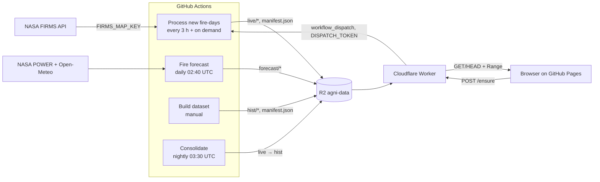
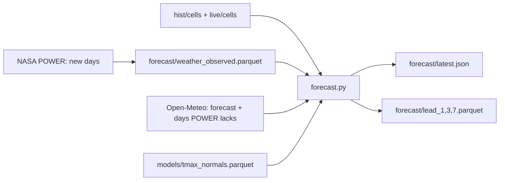

# AGNI architecture

AGNI shows 25 years of fire detections for Australia on one consistent footing: real VIIRS S-NPP
detections from 2012, and VIIRS-equivalent detections estimated from MODIS by the **Harmonic**
model before that and on days when no VIIRS satellite has data.

## Goals

- **Free tier only.** GitHub Pages, GitHub Actions, Cloudflare R2 and one Cloudflare Worker.
- **No server.** Nothing runs all the time. Scheduled jobs write files; the browser reads them.
- **One record.** The history and the days added later use the same columns, grid and day definition.
- **Secrets stay in GitHub.** The browser never sees a key.

## Components

| Component | Where | What it does |
|---|---|---|
| Website | `frontend/`, GitHub Pages | React app. Answers every query in the browser from Parquet files (`frontend/src/api/engine/`). |
| Worker | `worker/src/index.ts`, Cloudflare Workers | Serves dataset files from R2 (with Range requests). Starts processing for days a visitor asks for that aren't stored yet. |
| Bucket | R2 `agni-data` | All dataset files, under one prefix per dataset (`mock/`, `real/`). |
| Pipeline | `pipeline/agni_pipeline/`, GitHub Actions | Builds the history, adds new days from NASA FIRMS, folds finished days into the history, runs the forecast. |
| Harmonic | `pipeline/harmonic/` (ML team) | MODIS → VIIRS-equivalent model, used on days without VIIRS. |
| Forecast model | `pipeline/forecast/` (ML team) | Experimental 1, 3 and 7 day fire forecast. |
| FastAPI backend | `backend/` | Not used in production. Kept for development: the website uses it only when built with `VITE_API_BASE`. The pipeline reuses its builder (`backend/scripts/build_viirs.py`) for the CSV path and the default day/night weights. |

## Workflows

| Workflow (file) | When | What |
|---|---|---|
| Build dataset (`build-data.yml`) | manual, `mock` or `real` | `build_hist`: every `.parquet` under `<dataset>/source/` → `hist/*` and a fresh `manifest.json`. `mock` uses the backend's synthetic data. |
| Process new fire-days (`pipeline.yml`) | `17 */3 * * *` and on demand | `process_days --recent 3 --fill-missing --upgrade`: new and missing days, plus upgrades of stored days. At most 62 days per run. |
| Add processed days to the main dataset (`consolidate.yml`) | `30 3 * * *` | `consolidate`: moves finished live days into `hist/`. Optional full CSV export. |
| Fire forecast (experimental) (`forecast.yml`) | `40 2 * * *` | `forecast`: writes `forecast/latest.json` and `forecast/lead_<L>.parquet`. Dataset `real` by default. |
| Deploy Worker to Cloudflare (`deploy-worker.yml`) | push to `worker/` | Type-checks and deploys with Wrangler; uploads `DISPATCH_TOKEN` as a Worker secret. |
| Deploy frontend to GitHub Pages (`deploy-frontend.yml`) | push to `frontend/` | Builds with `VITE_DATA_URL` and `VITE_WORKER_URL`. |

`pipeline.yml`, `consolidate.yml` and `build-data.yml` share one concurrency group per dataset
(`agni-data-<dataset>`), so only one job writes `manifest.json` at a time. The forecast has its own
group: it only reads the manifest.

## R2 layout

Everything for one dataset lives under its prefix, e.g. `real/`.

| Key | Written by | Contents |
|---|---|---|
| `manifest.json` | build, process, consolidate | Record start and end (`local_end`), known gaps, source periods, every live day with its source and status, `live_months`, `row_years` (year → version stamp), `updated_at`. |
| `hist/cells.parquet` | build, consolidate | Detections summed per 0.1° cell × fire-day × pass × type × origin. Sorted by date and cell, row groups of 50,000. |
| `hist/cells_month.parquet` | build, consolidate | The same per cell × year × month. Sorted by grid row (`cj`) first. |
| `hist/day_status.parquet` | build, consolidate | Per fire-day: `has_data` (full / partial / none), `daynight_reliable`, `flag`. |
| `hist/day_totals.parquet` | build, consolidate | All-Australia totals per fire-day × pass × type × origin. Small; loaded whole. |
| `hist/rows/YYYY.parquet` | build, consolidate | Every detection of one year (15 VIIRS columns + `fire_date`, `pass`, `origin`, `ci`, `cj`, `weight`). Used for CSV downloads. |
| `live/cells/YYYY-MM.parquet`, `live/rows/YYYY-MM.parquet` | process, consolidate | Days after `local_end`, one file per month. |
| `source/…` | you (`real` only) | Input: per-year Parquet files, any names and subfolders. Optional `source/day_status.parquet` (or `.csv`). |
| `csv/agni_processed.csv` | consolidate (when asked) | Full processed CSV export, 15 columns. |
| `pending/<day>`, `pending/_dispatch` | Worker | Markers for days being processed and the last workflow start. Expire after 15 min / 30 s. |
| `forecast/latest.json` | forecast | Issue day, targets, national totals with P5–P95 range, accuracy, weather sources, version. |
| `forecast/lead_<L>.parquet` | forecast | Per cell: `ci`, `cj`, `p` (chance of ≥1 detection), `expected`. L = 1, 3, 7. |
| `forecast/weather_observed.parquet` | uploaded once, then forecast | NASA POWER daily weather, last 731 days. Not served by the Worker. |

`hist/rows.parquet` (one file for all years) is an older layout. Build and consolidate remove it;
the website still reads it if `row_years` is missing.

## Day and grid definitions

- **Fire-day:** local solar time minus 6 hours. Solar time is UTC plus `longitude × 4 min`. A fire-day
  runs from 6 am to 6 am, so a 1:30 am pass belongs to the previous evening's day.
- **Pass:** `D` when the solar hour is 6–17, otherwise `N`.
- **Cell:** 0.1° grid, `ci = floor(lon × 10)`, `cj = floor(lat × 10)` (south-west corner).
- **Area:** lon 112 to 154, lat −44 to −9. Record starts 2000-11-01.
- **Origin:** from the `version` column. `2` → `real`, `ML-…-gapfill` → `gapfill`, other `ML-…` → `ml`.
  Any other version stops the build.
- **Weight:** 1 for real VIIRS rows. Model rows carry a per-month day/night weight (from Harmonic's
  `training_report.json` when present, else the backend builder's table).
- **Day status** (when no status file is given): `none` = no detections, `partial` = next to a `none`
  day, otherwise `full`. Under 100 detections only adds the flag `low_coverage`. Gap-filled days from
  2022 are marked `daynight_reliable = false`.

## Adding new days

`process_days` handles each fire-day after `local_end` in this order. The first that answers wins.

| Order | Source | Origin |
|---|---|---|
| 1 | `VIIRS_SNPP_SP` (NASA's final data) | `firms_sp` |
| 2 | `VIIRS_SNPP_NRT` | `firms_nrt` |
| 3 | `VIIRS_NOAA20_SP`, `VIIRS_NOAA20_NRT` | `firms_sp` / `firms_nrt`, flag `snpp_offline` |
| 4 | `VIIRS_NOAA21_SP`, `VIIRS_NOAA21_NRT` | same |
| 5 | `MODIS_SP` / `MODIS_NRT` → Harmonic | `gapfill`, flag `viirs_offline` |
| 6 | nothing | `none`, retried after 6 h |

- A VIIRS answer counts only with at least 20 detections Australia-wide (`AGNI_MIN_VIIRS`). If no product
  reaches that and MODIS is missing too, the largest VIIRS answer is kept as `partial` (`firms_low`).
- Harmonic reads MODIS from 30 days before to 15 days after the day. A day estimated before those
  15 days existed is estimated again later.
- The last 3 days are `provisional`. Today's fire-day is `partial`.
- Without the trained Harmonic files the pipeline refuses to process real days.

`--upgrade` revisits stored days (at most every 12 h, using FIRMS's availability list):

- a day not on final data, once NASA publishes the `_SP` version (about 2–3 months later, with the
  static-source `type`);
- a day from the last 30 days on NOAA-20/21 or Harmonic, when S-NPP is back;
- a recent Harmonic day, when any VIIRS now has it.

## Consolidation

Nightly, `consolidate` moves live days into `hist/` when all of these hold:

- older than 3 days and not `provisional`;
- on NASA's final data (`_SP`), **or** older than 150 days (NASA had its chance);
- part of an unbroken run starting the day after `local_end` (so the record has no holes).

Only the year files that receive days are rewritten. Cells, monthly cells, day status and totals
are rebuilt with the new days. The live month files are then trimmed or deleted, and `local_end`
moves forward. Near-real-time days stay live until upgraded, so the history never needs rewriting.

## How the site answers queries

The browser engine (`frontend/src/api/engine/`) is a port of the backend's analytics in plain
JavaScript over **hyparquet** (about 21 KB). There is no database in the browser.

1. Fetch `manifest.json` (`no-store`).
2. Load the small files whole and keep them in memory: `hist/day_status`, `hist/day_totals`, every
   `live/cells/YYYY-MM`.
3. Queries for all of Australia use the totals. Smaller areas read the big files in parts:
   the footer once, then only row groups whose min/max statistics can match, in parallel.
   - `hist/cells` is pruned by `fire_date`, `hist/cells_month` by `cj`.
   - CSV downloads open only the `hist/rows/YYYY` files of the period (pruned by `fire_date`) and the
     matching `live/rows` months (whole).
4. When a visitor looks at days after `local_end` that are missing, the site calls the Worker's
   `POST /ensure {dataset, start, end}`. The Worker checks the manifest and pending markers, then starts
   `pipeline.yml` with those days (at most 62, one start per 30 s). The site polls `GET /pending/<dataset>`
   and reloads the manifest when the run finishes.
5. The forecast tab reads `forecast/latest.json` (`no-store`) and one `forecast/lead_<L>.parquet`.

Without `VITE_DATA_URL` the site uses the mock dataset bundled in `frontend/public/data/mock`.

## Caching and versioning

Every data file URL carries `?v=<version>`, so a changed file always gets a new URL.

| File | Version used |
|---|---|
| `hist/cells`, `cells_month`, `day_status`, `day_totals` | newest stamp in `row_years` (falls back to `local_end`) |
| `hist/rows/YYYY` | that year's stamp in `row_years` |
| `live/*/YYYY-MM` | newest `processed_at` of that month's days |
| `forecast/lead_<L>` | `version` in `latest.json` |

The newest stamp changes on every history write. The record end alone is not enough: a rebuild can end
on the same date as the last one, and the browser would mix cached old bytes with the new file.

Worker cache headers:

| Request | `Cache-Control` |
|---|---|
| `manifest.json`, `forecast/latest.json` | `no-store` |
| any file with `?v=` | `public, max-age=31536000, immutable` |
| other `hist/` files | `public, max-age=3600` |
| anything else | `public, max-age=60` |

The Worker supports `Range` (206 with `Content-Range`), `HEAD` (a `HEAD` with `Range` answers 206 with
the full size) and CORS for the origins in `ALLOWED_ORIGINS`. It serves only an allow-list:
`manifest.json`, `hist/<name>.parquet`, `hist/rows/YYYY.parquet`, `live/{cells,rows}/YYYY-MM.parquet`,
`forecast/latest.json`, `forecast/lead_<digit>.parquet`. Source files, CSV exports, pending markers and
the observed weather are not served.

## Experimental forecast

`forecast.py` runs the ML team's forecast v5 (one XGBoost model per lead: 1, 3, 7 days) once a day.

- **Issue day:** the newest finished fire-day with data (or the `issue` input).
- **Fire history:** vegetation fires (`type 0`) from all origins, mapped onto the model's grid.
- **Weather:** the stored POWER file is extended each run (last 10 days refetched) and trimmed to 731
  days. Open-Meteo fills the days after it, about 700 points.
- **Output:** cells with `p ≥ 0.01` or `expected ≥ 0.02`; national totals with a P5–P95 range from
  200 simulations; accuracy figures from `models/evaluation_report.json`.
- It runs without touching `manifest.json`. The mock dataset has no forecast: `latest.json` is a 404 and the site treats that as "no forecast".

## Security

| Secret | Where | Used by |
|---|---|---|
| `FIRMS_MAP_KEY` | GitHub secret | `pipeline.yml` only. Sent to FIRMS from Actions; never stored in R2 or the frontend. |
| `R2_ACCOUNT_ID`, `R2_ACCESS_KEY_ID`, `R2_SECRET_ACCESS_KEY` | GitHub secrets | pipeline, consolidate, build, forecast (S3 API). |
| `CLOUDFLARE_API_TOKEN`, `CLOUDFLARE_ACCOUNT_ID` | GitHub secrets | Worker deploy. |
| `DISPATCH_TOKEN` | GitHub secret → Worker secret | Worker only, to start `pipeline.yml`. Fine-grained, this repo, Actions read/write. |

- The frontend bundle holds only public URLs (`VITE_DATA_URL`, `VITE_WORKER_URL`).
- The Worker reads R2 through its binding; it has no S3 keys. It never calls FIRMS and never runs a model.
- `/ensure` accepts only listed datasets, valid dates and days after `local_end`, up to today, and limits
  workflow starts, so a visitor cannot run arbitrary jobs.
- The Worker config (`worker/wrangler.jsonc`) holds the non-secret settings: `DATASETS`,
  `ALLOWED_ORIGINS`, `GITHUB_REPO`, `GITHUB_WORKFLOW`, `GITHUB_REF`.

## More

- Deployment and setup: [DEPLOYMENT.md](DEPLOYMENT.md)
- Replacing Harmonic or the real data: [`pipeline/MODEL_AND_DATA_UPDATE.md`](../pipeline/MODEL_AND_DATA_UPDATE.md)
- Harmonic: [`pipeline/harmonic/README.md`](../pipeline/harmonic/README.md)
- Forecast model: [`pipeline/forecast/README.md`](../pipeline/forecast/README.md)
- API shapes (used by the browser engine and the backend): [API_CONTRACT.md](API_CONTRACT.md)
